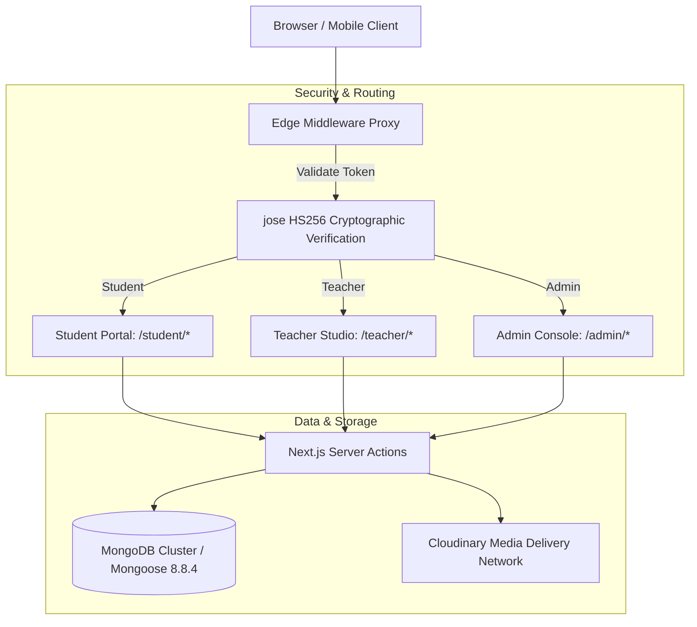

# KnightED — Academic Peer-Tutoring & Resource Management Platform

> **Category:** Academic Systems & Distributed Learning  
> **Target Audience:** Cedar College Student Body & Cambridge O/A-Level Candidates  
> **Framework & Runtime:** Next.js 16.1.6 (App Router) | React 18 | TypeScript 5.8.3  
> **Database:** MongoDB with Mongoose 8.8.4 (17 Relational Models)  
> **Asset Infrastructure:** Cloudinary SDK v2.5.0 (Video Streaming & Document Storage)  
> **Authentication:** Edge JWT (`jose` HS256) & bcryptjs (12 Salt Rounds)  
> **Live Production Platform:** https://knightedx.vercel.app  
> **Author & Creator:** Muhammad Rayyan Kashif (100% Individual Architecture & Implementation)  

---

## 1. Project Overview & Institutional Origin

**KnightED** was conceived, designed, and engineered specifically for **Cedar College** and the **Cedar Knights** student community. In rigorous Cambridge International Examination (CAIE) environments, high school students routinely face fragmented study workflows: video lessons are scattered across external video platforms, revision notes are traded informally across messaging apps, and past papers lack structured organization with corresponding marking schemes.

To resolve this operational friction, KnightED was built as an institutional learning portal. It provides Cedar students with a unified academic hub for student-to-student peer-tutoring courses, granular lecture video progress tracking, searchable revision notes, and an indexed Cambridge past-paper archive. After completing and validating the platform for the school community, the architecture was structured for open-source distribution.

---

## 2. Problem Statement & Core Purpose

* **Fragmented Study Channels:** Students had no single repository linking video explanations with official Cambridge past papers and lecture handouts.
* **Lack of Accountability in Peer Tutoring:** Student tutors lacked tools to organize chapters, reorder syllabus modules, or track which students completed lessons.
* **Unstructured Past-Paper Practice:** Cambridge past papers require pairing specific question paper variants with their exact marking schemes across exam sessions (May/June vs. Oct/Nov).
* **Hydration & Latency Bottlenecks:** Modern educational web portals often struggle with layout shifts and server-client state desynchronization during video playback and syllabus browsing.

---

## 3. System Architecture & Engineering Design

KnightED is architected as a high-performance Next.js 16 full-stack application utilizing the App Router paradigm. Access control, role segregation, and data retrieval are partitioned across three tiers:

### Architectural Pillars:
* **Edge Proxy Authentication:** An edge-level middleware interceptor verifies stateless HTTP session cookies prior to route execution, enforcing strict role-based access control (RBAC).
* **Unified Server Actions:** Database operations utilize Server Actions that serialize Mongoose documents into plain objects, eliminating Next.js Server Component hydration warnings.
* **Decoupled Media Pipeline:** Video lessons, syllabus handouts, and past-paper PDFs are delivered through an optimized CDN pipeline, ensuring zero media load on the primary web server.

---

## 4. Key Engineering Implementations

### A. Edge-Level Role-Based Access Control
Security is enforced at the edge rather than via client-side layout checks. The interceptor inspects incoming requests:
* **Public & Auth Routes:** Whitelists registration and login endpoints.
* **Session Verification:** Extracts the session token, decrypts the payload with a 256-bit secret key using `jose`, and extracts the user ID, email, and role.
* **Route Enclosure:** 
  - Students attempting to access teacher or admin routes are redirected to course discovery.
  - Teachers attempting to browse student routes are redirected to their course management studio.
  - Administrators maintain comprehensive superuser clearance across all modules.

### B. Drag-and-Drop Curriculum Reordering Engine
Course instructors require an intuitive mechanism to organize chapters and syllabus milestones.
* Integrated a flexible drag-and-drop interface powered by `@hello-pangea/dnd`.
* Drag events calculate updated sequential position integers in state.
* Dispatches an atomic batch reordering payload to the API, updating positions across the chapter collection in a single database round-trip without race conditions.

### C. Timestamp-Synchronized Video Note System
Traditional video learning disconnects note-taking from playback.
* Engineered a synchronized note-taking module linked to HTML5 video elements.
* When a student records a note, the system captures the exact playback time down to the second and binds it to the note record.
* In the study interface, clicking any saved note automatically seeks the video player directly to that second, enabling instant context recovery.

### D. Cambridge Examination Taxonomy & Archive
Organizing Cambridge past papers requires strict structural modeling:
* Designed a schema capturing the official examination hierarchy: Qualification Level (O/A Level) $
ightarrow$ Subject Category $
ightarrow$ Examination Year $
ightarrow$ Session (Summer vs. Winter) $
ightarrow$ Component Variant (e.g., Paper 12, Paper 22).
* Dynamically pairs Question Papers with their official Marking Schemes side-by-side, enabling students to self-assess practice exams in real time.

### E. Mathematical Progress Aggregation Pipeline
To eliminate N+1 database queries when rendering course dashboards:
* Server actions concurrently resolve total published chapters alongside the user’s completed progress records using database aggregation.
* Calculates mathematical completion percentages dynamically:
  $$	ext{Progress \%} = \left( rac{	ext{Completed Chapters}}{	ext{Total Published Chapters}} 
ight) 	imes 100$$
* Automatically triggers a celebratory visual milestone when 100% completion is recorded.

---

## 5. Technical Stack & Specifications

* **Frontend Framework:** Next.js 16.1.6 (App Router) on React 18
* **Language:** TypeScript 5.8.3 (Strict Type Checking)
* **Data Modeling:** Mongoose 8.8.4 on MongoDB (17 relational models including User, Course, Chapter, VideoProgress, PastPaper, Note, and Comment)
* **Media Infrastructure:** Cloudinary SDK v2.5.0
* **Typography:** Local Clash Display typeface suite (Extralight, Light, Regular, Medium, Semibold, Bold)
* **UI Design System:** Tailwind CSS, Radix UI headless primitives, TanStack Table, Recharts, Lucide Icons
* **Form Validation:** React Hook Form paired with Zod schemas

---

## 6. Author Role & Scope of Ownership

* **Scope:** **100% Solo Design & Engineering**.
* **Individual Contribution:** Conceived the platform concept, designed the UI tokens and typography, modeled all 17 database schemas, engineered the edge middleware proxy, built the video playback and note-taking mechanics, and structured the past-paper repository for Cedar College.
