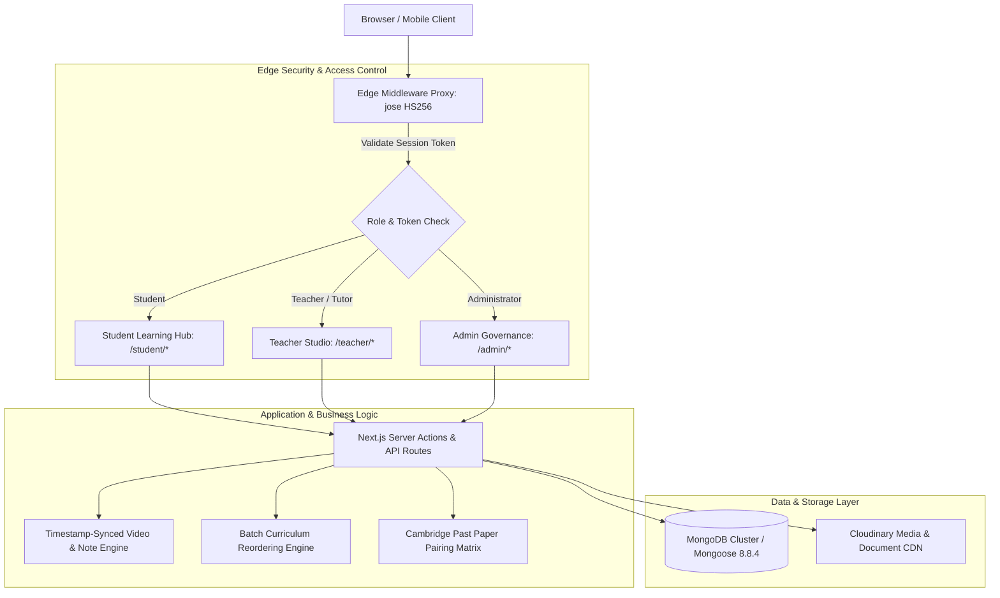

<div align="center">

# ⚔️ KnightED

**Official Academic Peer-Tutoring & Cambridge Resource Platform for Cedar College**

[](https://nextjs.org/)
[](https://www.typescriptlang.org/)
[](https://react.dev/)
[](https://mongoosejs.com/)
[](https://tailwindcss.com/)
[](https://knightedx.vercel.app/)
[](https://opensource.org/licenses/MIT)

<p align="center">
  <em>Conceived, architected, and engineered for the <b>Cedar College</b> student body (The Cedar Knights) and Cambridge Assessment International Education (CAIE) candidates.</em>
</p>

> 🌐 **Live Production Deployment:** [https://knightedx.vercel.app](https://knightedx.vercel.app)

[Live Platform](https://knightedx.vercel.app) •
[System Architecture](#-system-architecture) •
[Key Engineering Implementations](#-key-engineering-implementations) •
[Data Models](#-data-models--schema-architecture) •
[Tech Stack](#-technical-stack--specifications) •
[Quickstart](#-getting-started) •
[Deep Technical Specs (Detail.md)](./Detail.md)

</div>

---

## 🏛️ 1. Project Overview & Institutional Origin

In rigorous Cambridge International Examination (CAIE) high-school environments, students consistently encounter severe friction across their academic workflows:
* Video tutorials are scattered across external video hosting platforms without syllabus alignment.
* Revision notes and chapter summaries circulate through unorganized messaging groups.
* Official Cambridge past papers require manually searching for and matching corresponding Question Paper variants with their exact Marking Schemes across exam series (May/June vs. Oct/Nov).
* Student tutors lack accountability tooling to structure courses, enforce chapter sequencing, or observe peer progress.

**KnightED** was built to resolve this fragmentation. Developed from the ground up for **Cedar College**, it serves as an all-in-one academic portal that unifies student-to-student peer tutoring courses, second-precise video lecture progress tracking, synchronized timestamp note-taking, and an indexed Cambridge past-paper archive.

> **Developer & Creator:** Muhammad Rayyan Kashif  
> **Institutional Context:** Cedar College (Karachi, Pakistan) — *High School Class Rank: 1 / 549, 4.00 Cumulative GPA, Cedar Scholar Award*  
> **Engineering Scope:** 100% Solo Concept, Architecture & Full-Stack Implementation  

---

## 📐 2. System Architecture

KnightED is built on the **Next.js 16 App Router** paradigm, combining stateless edge proxy authentication, optimized server actions, and a decoupled media streaming pipeline:



### Architectural Highlights:
1. **Edge Proxy Interceptor:** Session tokens are cryptographically verified at the edge before request execution, eliminating layout flashes and preventing unauthorized route hydration.
2. **Hydration-Safe Server Actions:** Database queries convert raw Mongoose documents into sanitized JSON objects before server components render, preventing React hydration mismatches.
3. **Decoupled CDN Pipeline:** Video lessons, downloadable PDF handouts, and past-paper documents stream via Cloudinary, ensuring zero heavy media load on the core application server.

---

## ⚡ 3. Key Engineering Implementations

### A. Stateless Edge Role-Based Access Control (RBAC)
Security is enforced at the network edge rather than relying on client-side React layout checks:
* The middleware intercepts incoming requests to inspect the `session_token` HTTP-only cookie.
* The token payload is verified using `jose` with an HMAC-SHA256 256-bit secret key, extracting user credentials and role claims.
* Enforces strict boundary enclosures:
  - Students attempting to browse teacher studio routes are dynamically redirected to course discovery.
  - Teachers accessing student discovery portals are routed back to their management console.
  - Administrative accounts maintain global elevated clearance across all course hierarchies.

### B. Timestamp-Synchronized Video Note Engine
Traditional online learning disconnects personal note-taking from video lectures:
* Interfaced directly with HTML5 video elements to capture playback progression down to the exact second.
* When a student records a question or key takeaway, the note record automatically stores a high-precision `timestampSeconds` value.
* Clicking any saved note in the sidebar triggers an imperative seek operation:
  $$\text{Player.currentTime} = \tau_{\text{saved}}$$
  This instantly jumps the video to that exact explanation without manual scrubbing.

### C. Atomic Drag-and-Drop Curriculum Reordering Engine
Tutors need an intuitive, responsive interface to structure multi-week syllabi:
* Integrated `@hello-pangea/dnd` for smooth drag-and-drop interactions across chapter lists.
* Drag-end events immediately compute new sequential integer indexes in optimistic local state.
* Dispatches a single batch reordering payload to an atomic server action that updates chapter positions across the database collection in a single round-trip, completely eliminating race conditions.

### D. Cambridge Examination Taxonomy & Archive
Cambridge past papers follow a rigorous five-level categorization hierarchy:
$$\text{Qualification Level (O/A Level)} \longrightarrow \text{Subject} \longrightarrow \text{Year} \longrightarrow \text{Session (Summer/Winter)} \longrightarrow \text{Variant}$$
* Built a dedicated relational taxonomy schema pairing Question Papers (QP) with their exact Marking Schemes (MS).
* Renders an interactive side-by-side assessment viewer, enabling students to solve exam questions and self-evaluate against official Cambridge marking guidelines in real time.

### E. Mathematical Progress Aggregation Pipeline
To prevent $N+1$ query bottlenecks when rendering student progress dashboards:
* Server Actions utilize MongoDB aggregation pipelines to resolve total published chapters alongside completed progress records in a unified query.
* Computes mathematical progress metrics on the fly:
  $$\text{Progress \%} = \left( \frac{\text{Completed Chapters}}{\text{Total Published Chapters}} \right) \times 100$$
* Automatically dispatches a celebratory milestone trigger (`react-confetti`) when 100% course completion is verified.

---

## 🗄️ 4. Data Models & Schema Architecture

KnightED models complex academic interactions across **17 Mongoose schemas**:

| Schema | Purpose & Key Attributes |
|---|---|
| `User` | Student, Teacher, and Admin credentials, bcrypt password hashes, and profile avatars. |
| `Course` | Title, description, thumbnail URL, publication status, category relation, and pricing tier. |
| `Chapter` | Course chapters, sequential integer position index, video URL, and publication flag. |
| `VideoProgress` | Tracks per-user video completion states, total seconds watched, and completion boolean. |
| `VideoNote` | Timestamped student notes bound to exact video playback seconds (`timestampSeconds`). |
| `PastPaper` | Cambridge exam papers indexed by level, subject, year, session, variant, QP, and MS URLs. |
| `PastPaperProgress` | Tracks completed past paper variants and self-evaluated marks. |
| `Note` / `NoteProgress` | Downloadable revision guides, PDF summaries, and student reading completion logs. |
| `Enrollment` | Relational join mapping student enrollments to active courses. |
| `Bookmark` | Student saved courses and pinned revision resources for rapid access. |
| `Comment` / `CourseComment` | Threaded Q&A discussions linked to specific course chapters and tutors. |
| `Attachment` | Supplementary downloadable lecture handouts, homework sheets, and formula guides. |
| `Category` | High-level academic taxonomy (Mathematics, Physics, Chemistry, Computer Science). |
| `Notification` | System notifications alerting students to newly published chapters and tutor responses. |

---

## 🛠️ 5. Technical Stack & Specifications

| Layer | Technology | Version | Engineering Rationale |
|---|---|---|---|
| **Framework** | Next.js (App Router) | `16.1.6` | Server Components, streaming SSR, and built-in Edge Middleware. |
| **Language** | TypeScript | `5.8.3` | Strict end-to-end type safety across schemas, actions, and UI props. |
| **Frontend Core** | React / React DOM | `18.0.0` | Concurrent rendering, optimistic state updates, and transition hooks. |
| **Database** | MongoDB / Mongoose | `8.8.4` | Flexible document modeling for nested curriculum trees and progress logs. |
| **Edge Security** | `jose` | `6.1.0` | Lightweight, edge-runtime compliant HMAC-SHA256 cryptographic JWT verification. |
| **Hashing** | `bcryptjs` | `2.4.3` | Cryptographic password hashing (12 salt rounds) for credential storage. |
| **Drag & Drop** | `@hello-pangea/dnd` | `16.6.0` | Accessible, touch-responsive drag-and-drop curriculum reordering. |
| **Styling** | Tailwind CSS | `2.6.0` | Utility-first CSS architecture with custom CSS variables and dark mode. |
| **Component Primitives** | Radix UI | Latest | Accessible, unstyled headless UI components (Dialog, Select, Popover, Progress). |
| **Form Validation** | React Hook Form & Zod | `7.56.3` / `3.24.4` | Strict client-side and server-side input schema validation. |
| **Media Delivery** | Cloudinary SDK | `2.5.0` | Optimized video transcoding, adaptive bitrate delivery, and secure document CDN. |

---

## 🚀 6. Getting Started

### Prerequisites
* **Node.js**: `v18.17.0` or higher
* **MongoDB**: A running local MongoDB instance or a [MongoDB Atlas](https://www.mongodb.com/atlas) connection URI
* **Cloudinary Account**: For video and document asset management

### Installation & Setup

1. **Clone the repository:**
   ```bash
   git clone https://github.com/muhammadrayyankashif/KnightED.git
   cd KnightED
   ```

2. **Install dependencies:**
   ```bash
   npm install
   ```

3. **Configure Environment Variables:**
   Create a `.env` file in the root directory by copying the provided example:
   ```bash
   cp .env.example .env
   ```
   Fill in your connection credentials:
   ```env
   MONGODB_URI=mongodb+srv://<username>:<password>@cluster0.mongodb.net/knighted
   JWT_SECRET=your-super-secret-jwt-key-min-32-chars
   CLOUDINARY_CLOUD_NAME=your_cloudinary_cloud_name
   CLOUDINARY_API_KEY=your_cloudinary_api_key
   CLOUDINARY_API_SECRET=your_cloudinary_api_secret
   NEXT_PUBLIC_APP_URL=http://localhost:3000
   ```

4. **Run the development server:**
   ```bash
   npm run dev
   ```
   Open [http://localhost:3000](http://localhost:3000) with your browser to experience KnightED.

5. **Build for production:**
   ```bash
   npm run build
   npm run start
   ```

---

## 📖 7. Comprehensive Engineering Specification

For an exhaustive, technical deep-dive into the architectural mechanics, state synchronization flows, and algorithmic structures, read the dedicated engineering specification:

👉 **[View the In-Depth Engineering Specification (Detail.md)](./Detail.md)**

---

## 📄 8. License & Authorship

* **Author:** **Muhammad Rayyan Kashif** (Cedar College, Class of 2027)
* **Scope:** 100% Solo Design, Architecture & Full-Stack Development
* **License:** Distributed under the [MIT License](https://opensource.org/licenses/MIT).
